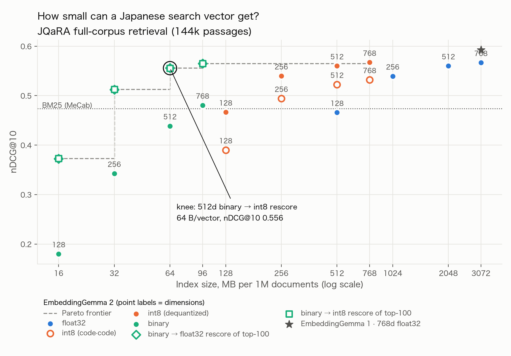

# Results

Dataset: `hotchpotch/JQaRA` (test), 1,667 queries.
*full* = exact top-100 retrieval over all 144,372 test passages; *rerank* = official JQaRA protocol (rank each query's 100 candidates).

## EmbeddingGemma 2: Matryoshka × quantization grid

| config                        |   bytes/vec (RAM) |   bytes/vec (disk) |   compression × |   nDCG@10 (full) |   R@100 (full) |   MRR@10 (full) |   nDCG@10 (rerank) |   % of 768d fp32 |
|:------------------------------|------------------:|-------------------:|----------------:|-----------------:|---------------:|----------------:|-------------------:|-----------------:|
| 768d float32                  |              3072 |               3072 |             1   |           0.5668 |         0.8959 |          0.7901 |             0.5832 |           100    |
| 768d int8 (code·code)         |               768 |                768 |             4   |           0.5321 |         0.8881 |          0.755  |             0.5516 |            93.88 |
| 768d int8 (dequantized)       |               768 |                768 |             4   |           0.5671 |         0.8956 |          0.7903 |             0.5835 |           100.1  |
| 768d binary                   |                96 |                 96 |            32   |           0.4805 |         0.7985 |          0.7131 |             0.5137 |            84.79 |
| 768d binary → float32 rescore |                96 |               3168 |            32   |           0.565  |         0.7985 |          0.7894 |           nan      |            99.69 |
| 768d binary → int8 rescore    |                96 |                864 |            32   |           0.5651 |         0.7985 |          0.7894 |           nan      |            99.71 |
| 512d float32                  |              2048 |               2048 |             1.5 |           0.5601 |         0.8894 |          0.7828 |             0.5781 |            98.82 |
| 512d int8 (code·code)         |               512 |                512 |             6   |           0.5225 |         0.8796 |          0.7427 |             0.5441 |            92.2  |
| 512d int8 (dequantized)       |               512 |                512 |             6   |           0.5601 |         0.8893 |          0.7827 |             0.5778 |            98.82 |
| 512d binary                   |                64 |                 64 |            48   |           0.4387 |         0.75   |          0.6758 |             0.4818 |            77.4  |
| 512d binary → float32 rescore |                64 |               2112 |            48   |           0.5557 |         0.75   |          0.7819 |           nan      |            98.05 |
| 512d binary → int8 rescore    |                64 |                576 |            48   |           0.5555 |         0.75   |          0.7818 |           nan      |            98.02 |
| 256d float32                  |              1024 |               1024 |             3   |           0.5393 |         0.8659 |          0.7594 |             0.5604 |            95.16 |
| 256d int8 (code·code)         |               256 |                256 |            12   |           0.4942 |         0.8507 |          0.7135 |             0.5208 |            87.2  |
| 256d int8 (dequantized)       |               256 |                256 |            12   |           0.5396 |         0.8658 |          0.7602 |             0.561  |            95.21 |
| 256d binary                   |                32 |                 32 |            96   |           0.3426 |         0.6041 |          0.5658 |             0.4262 |            60.45 |
| 256d binary → float32 rescore |                32 |               1056 |            96   |           0.5121 |         0.6041 |          0.7489 |           nan      |            90.36 |
| 256d binary → int8 rescore    |                32 |                288 |            96   |           0.5127 |         0.6041 |          0.7494 |           nan      |            90.46 |
| 128d float32                  |               512 |                512 |             6   |           0.4658 |         0.7605 |          0.7003 |             0.5095 |            82.19 |
| 128d int8 (code·code)         |               128 |                128 |            24   |           0.3901 |         0.7109 |          0.6052 |             0.453  |            68.84 |
| 128d int8 (dequantized)       |               128 |                128 |            24   |           0.4666 |         0.7602 |          0.701  |             0.5101 |            82.33 |
| 128d binary                   |                16 |                 16 |           192   |           0.1801 |         0.3495 |          0.3445 |             0.3499 |            31.78 |
| 128d binary → float32 rescore |                16 |                528 |           192   |           0.3722 |         0.3495 |          0.6377 |           nan      |            65.68 |
| 128d binary → int8 rescore    |                16 |                144 |           192   |           0.3733 |         0.3495 |          0.6402 |           nan      |            65.86 |

**Knee** (smallest index keeping ≥95% of 768d fp32 full-corpus nDCG@10): **512d binary → int8 rescore** — 64 bytes/vector in RAM, 576 on disk (48× smaller), nDCG@10 0.5555 vs 0.5668.

## Baselines

| system                        | config                     |   nDCG@10 (full) |   R@100 (full) |   nDCG@10 (rerank) |   MRR@10 (rerank) |
|:------------------------------|:---------------------------|-----------------:|---------------:|-------------------:|------------------:|
| BM25 (MeCab)                  | —                          |           0.4736 |         0.7410 |             0.5107 |            0.7557 |
| EmbeddingGemma 1              | 768d float32               |           0.5924 |         0.9196 |             0.6028 |            0.8286 |
| EmbeddingGemma 2              | 768d float32               |           0.5668 |         0.8959 |             0.5832 |            0.7970 |
| BM25 + EmbeddingGemma 2 (RRF) | 256d int8 (dequantized)    |           0.5603 |         0.8770 |             0.5802 |            0.8030 |
| BM25 + EmbeddingGemma 2 (RRF) | 512d binary → int8 rescore |           0.5543 |         0.8509 |           nan      |          nan      |
| BM25 + EmbeddingGemma 2 (RRF) | 768d float32               |           0.5674 |         0.8904 |             0.5875 |            0.8129 |

## EmbeddingGemma 1: same grid (for comparison)

| config                        |   nDCG@10 (full) |   R@100 (full) |   nDCG@10 (rerank) |
|:------------------------------|-----------------:|---------------:|-------------------:|
| 768d float32                  |           0.5924 |         0.9196 |             0.6028 |
| 768d int8 (code·code)         |           0.5737 |         0.9091 |             0.5869 |
| 768d int8 (dequantized)       |           0.5927 |         0.9197 |             0.6032 |
| 768d binary                   |           0.5308 |         0.8679 |             0.5518 |
| 768d binary → float32 rescore |           0.5924 |         0.8679 |           nan      |
| 768d binary → int8 rescore    |           0.5928 |         0.8679 |           nan      |
| 512d float32                  |           0.5816 |         0.9119 |             0.5937 |
| 512d int8 (code·code)         |           0.5538 |         0.8928 |             0.5705 |
| 512d int8 (dequantized)       |           0.5815 |         0.9120 |             0.5938 |
| 512d binary                   |           0.4914 |         0.8258 |             0.5173 |
| 512d binary → float32 rescore |           0.5802 |         0.8258 |           nan      |
| 512d binary → int8 rescore    |           0.5800 |         0.8258 |           nan      |
| 256d float32                  |           0.5432 |         0.8744 |             0.5623 |
| 256d int8 (code·code)         |           0.5064 |         0.8486 |             0.5313 |
| 256d int8 (dequantized)       |           0.5426 |         0.8743 |             0.5616 |
| 256d binary                   |           0.3951 |         0.6964 |             0.4521 |
| 256d binary → float32 rescore |           0.5362 |         0.6964 |           nan      |
| 256d binary → int8 rescore    |           0.5357 |         0.6964 |           nan      |
| 128d float32                  |           0.4805 |         0.8044 |             0.5133 |
| 128d int8 (code·code)         |           0.4286 |         0.7580 |             0.4725 |
| 128d int8 (dequantized)       |           0.4806 |         0.8051 |             0.5137 |
| 128d binary                   |           0.2526 |         0.4773 |             0.3654 |
| 128d binary → float32 rescore |           0.4355 |         0.4773 |           nan      |
| 128d binary → int8 rescore    |           0.4357 |         0.4773 |           nan      |

## CPU query-encode latency

Apple M1 Pro, 8 threads, 16.0 GB RAM; end-to-end incl. tokenization; real JQaRA queries.

| backend           |   batch |   model MB |   p50 ms/batch |   p95 ms/batch |   ms/query |   queries/s |
|:------------------|--------:|-----------:|---------------:|---------------:|-----------:|------------:|
| PyTorch fp32      |       1 |       1084 |           77.4 |           82.2 |       77.4 |        12.9 |
| PyTorch fp32      |      32 |       1084 |          756.9 |          820.4 |       23.7 |        42.3 |
| ONNX Runtime fp32 |       1 |       1090 |           63.1 |           91.5 |       63.1 |        15.9 |
| ONNX Runtime fp32 |      32 |       1090 |         1798.5 |         1893.6 |       56.2 |        17.8 |
| ONNX Runtime int8 |       1 |        278 |           38.2 |           54.2 |       38.2 |        26.2 |
| ONNX Runtime int8 |      32 |        278 |          891.2 |          989.3 |       27.9 |        35.9 |

### Does an int8 query encoder hurt retrieval?

All 1,667 queries re-encoded on CPU by each backend, scored against the same corpus.

| backend           |   cos_vs_torch_mean |   cos_vs_torch_min |   ndcg@10 full 768d float32 |   ndcg@10 full 256d int8_deq |   ndcg@10 full 512d ubinary+int8_deq |
|:------------------|--------------------:|-------------------:|----------------------------:|-----------------------------:|-------------------------------------:|
| PyTorch fp32      |              1.0000 |             1.0000 |                      0.5668 |                       0.5396 |                               0.5555 |
| ONNX Runtime fp32 |              1.0000 |             1.0000 |                      0.5668 |                       0.5396 |                               0.5555 |
| ONNX Runtime int8 |              0.9822 |             0.9294 |                      0.5547 |                       0.5280 |                               0.5430 |

